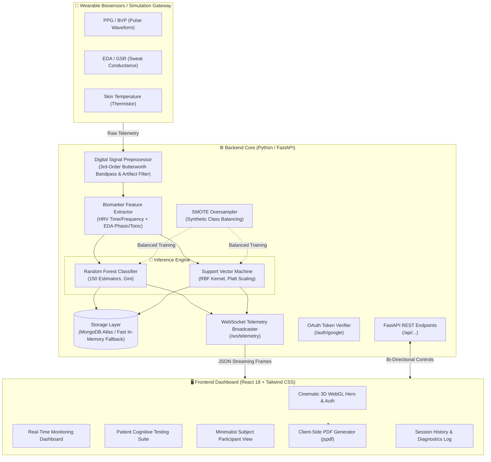

# 🧠 NeuroPulse: Real-Time Multi-Modal Stress Detection System
### *Physiological Telemetry, Early Dementia Cognitive Screening & Acute Stress Classification*

[](https://www.python.org/)
[](https://fastapi.tiangolo.com/)
[](https://scikit-learn.org/)
[](https://react.dev/)
[](https://tailwindcss.com/)
[](https://threejs.org/)
[](https://developers.google.com/identity)
[](https://www.mongodb.com/)
[](https://opensource.org/)
[](LICENSE)

**NeuroPulse** is an enterprise-grade physiological telemetry, acute mental stress monitoring, and neurocognitive screening platform (also internally utilized as the Early Dementia screening module). 

The platform continuously streams multi-channel autonomic biometric data—**Photoplethysmography / Blood Volume Pulse (BVP)**, **Electrodermal Activity (EDA / GSR)**, and **Peripheral Skin Temperature (SKT)**—filters signals using 3rd-order digital Butterworth filters, extracts time- and frequency-domain physiological biomarkers, handles class imbalance via **SMOTE**, and performs real-time machine learning inference with calibrated **Random Forest** and **Support Vector Machine (RBF)** classifiers.

---

## 📑 Table of Contents

- [Key Capabilities & Innovations](#-key-capabilities--innovations)
- [Multi-Tier Clinical Patient Examination](#-multi-tier-clinical-patient-examination)
- [System Architecture](#-system-architecture)
- [Folder & File Structure](#-folder--file-structure)
- [Physiological Signals & Feature Engineering](#-physiological-signals--feature-engineering)
- [Machine Learning Pipeline](#-machine-learning-pipeline)
- [Dataset Training & Evaluation](#-dataset-training--evaluation)
- [REST API & WebSocket Protocol](#-rest-api--websocket-protocol)
- [Frontend Dashboard Features](#-frontend-dashboard-features)
- [Zero-Cost ($0) Architecture & Security](#-zero-cost-0-architecture--security)
- [Installation & Getting Started](#-installation--getting-started)
  - [Prerequisites](#prerequisites)
  - [One-Click Automated Launch](#one-click-automated-launch-recommended)
  - [Manual Backend Setup](#1-backend-setup-python--fastapi)
  - [Manual Frontend Setup](#2-frontend-setup-react--tailwind-css)
- [Testing & Synthetic Stress Simulation](#-testing--synthetic-stress-simulation)
- [Troubleshooting & Port Resolution](#-troubleshooting--port-resolution)
- [License](#-license)

---

## 🌟 Key Capabilities & Innovations

* **Real-Time Multi-Modal Telemetry**: Low-latency WebSocket transmission (2–4 Hz) of continuous PPG/BVP, EDA/GSR, and Vasomotor Skin Temperature.
* **Multi-Tier Patient Examination**: Clinical diagnosis into 4 distinct diagnostic tiers:
  1. 🚨 **Dr. Consultant Required** (`DR_CONSULTANT_REQUIRED`)
  2. ⭐ **Good Resilience** (`GOOD`)
  3. ✅ **Normal Adaptive Response** (`NORMAL`)
  4. 🌿 **Baseline Calibrated** (`BASELINE`)
* **Neurocognitive Testing Battery**: Interactive clinical challenges designed for early cognitive and autonomic vulnerability screening:
  - **Stroop Color-Word Conflict** (Inhibitory control & prefrontal interference)
  - **Serial 7s Mental Subtraction** (Working memory under cognitive load)
  - **Digit Span Recall** (Short-term working memory capacity)
  - **4-7-8 Autonomic Restoration** (Vagal parasympathetic reactivation)
* **Instant Auto-Examine Mode**: Rapid standardized battery generating comprehensive clinical screening cards in seconds.
* **Client-Side PDF Clinical Reports**: Generates professional, multi-page diagnostic summary reports (with patient demographics, autonomic vitals, cognitive score breakdown, and doctor action plans) directly in the browser via `jspdf` with zero server computation cost.
* **Google OAuth 2.0 Integration**: Integrated `@react-oauth/google` authentication modal with Google Client ID support and Role-Based Access Control (RBAC).
* **Role-Based Access Control (RBAC)**:
  - **Researcher**: Full telemetry cockpits, dual model switcher, simulation controls, testing suite, and PDF export.
  - **Subject**: Minimal, calming participant screen featuring vitals and a guided 4s-in/4s-out breathing sphere (`SubjectView`).
* **Real-Time Recharts Biometric Curve**: High-frequency streaming AreaChart for Heart Rate and HRV RMSSD dynamics.
* **Fault-Tolerant Dual-Mode Storage**: Motor MongoDB Atlas support with automated 1.5s fast-fallback to in-memory caching. Zero crashes or 30-second timeouts if MongoDB is offline.
* **Automated Port Clearing Launchers**: Windows batch scripts (`run_all.bat`, `run_backend.bat`, `run_frontend.bat`) that automatically detect and terminate lingering zombie processes on ports `8000` and `3000`.

---

## 🩺 Multi-Tier Clinical Patient Examination

NeuroPulse provides a clinical patient roster with distinct physiological profiles:

| Patient ID | Name | Age | Profile & Autonomic Response | Diagnosed Clinical Tier | Recommendation / Action Plan |
| :--- | :--- | :--- | :--- | :--- | :--- |
| **PATIENT-101** | **Arthur Pendelton** | 74 | High sympathetic arousal, suppressed RMSSD (< 19ms), high EDA (7.4 µS) | 🚨 **Dr. Consultant Required** | Urgent neurologist & MoCA cognitive referral. Autonomic dysregulation flagged. |
| **PATIENT-104** | **Eleanor Vance** | 65 | Moderate adaptive HR (~82 BPM), healthy RMSSD (~33ms), adaptive EDA | ✅ **Normal Adaptive** | Healthy autonomic adaptation to cognitive workload. Standard age-matched follow-up. |
| **PATIENT-108** | **Marcus Chen** | 58 | Low HR (~65 BPM), high vagal tone (RMSSD > 45ms), low EDA arousal | ⭐ **Good Resilience** | Robust prefrontal executive control and superior parasympathetic recovery. |
| **PATIENT-112** | **Sarah Jenkins** | 62 | Resting equilibrium, steady HRV (RMSSD ~43ms), nominal vitals | 🌿 **Baseline Calibrated** | Calibrated resting baseline; all physiological indices nominal. |
| **Custom** | *Clinician Input* | Any | Real-time dynamic examination based on live or simulated participant data | *Dynamic* | Tailored diagnostic report and custom session tagging. |

---

## 🏗 System Architecture



---

## 📁 Folder & File Structure

```
stress-detection/
├── .github/                              # Continuous Integration workflows
│   └── workflows/
│       └── ci.yml                        # Automated backend & frontend validation
├── .gitignore                            # Comprehensive multi-stack ignore rules
├── .gitattributes                        # Cross-platform line endings & binary rules
├── LICENSE                               # MIT Open Source License
├── CONTRIBUTING.md                       # Contribution guidelines & code standards
├── SECURITY.md                           # Security vulnerability reporting policy
├── run_all.bat                           # 🚀 Root 1-click full-stack launcher
├── README.md                             # Comprehensive technical documentation
│
└── stress-detection-system/
    ├── run_all.bat                       # Full-stack launcher with auto-port freeing
    ├── run_backend.bat                   # Backend launcher (auto port 8000 free + venv detect)
    ├── run_frontend.bat                  # Frontend launcher (auto port 3000 free)
    │
    ├── backend/                          # FastAPI + Machine Learning Core
    │   ├── requirements.txt              # Python package dependencies
    │   ├── .env.example                  # Backend environment configuration template
    │   ├── saved_models/                 # Market-ready pre-trained model weights
    │   │   ├── random_forest_model.joblib
    │   │   ├── svm_model.joblib
    │   │   ├── scaler.joblib
    │   │   └── model_metrics.json
    │   ├── data/                         # Sample datasets & download guide
    │   │   ├── README.md                 # Dataset instructions
    │   │   ├── sample_train_dataset.csv
    │   │   └── sample_test_dataset.csv
    │   └── app/
    │       ├── main.py                   # FastAPI app, WebSocket route & Google auth
    │       ├── config/
    │       │   ├── db_config.py          # MongoDB client with 1.5s timeout & fallback
    │       │   └── websocket_config.py   # Connection manager for telemetry streaming
    │       ├── controllers/
    │       │   ├── telemetry_controller.py
    │       │   └── stress_classification_controller.py
    │       ├── hardware/
    │       │   ├── sensor_interface.py   # Hardware abstraction & virtual generator
    │       │   └── signal_preprocessor.py# SciPy Butterworth filter & peak detector
    │       ├── ml/
    │       │   ├── feature_extractor.py  # HRV and EDA time/frequency biomarker extraction
    │       │   ├── smote_oversampler.py  # Imbalanced-learn SMOTE oversampling
    │       │   ├── svm_classifier.py     # SVM classifier with RBF kernel
    │       │   ├── random_forest_classifier.py
    │       │   └── train_models.py       # Model training & validation script
    │       ├── models/
    │       │   ├── sensor_data.py        # Sensor input schema
    │       │   ├── hrv_eda_features.py   # Biomarker feature vector schema
    │       │   └── stress_state.py       # Acute stress diagnosis schema
    │       ├── repositories/
    │       │   └── telemetry_repository.py# In-memory + MongoDB dual-mode store
    │       └── services/
    │           ├── data_pipeline_service.py # Buffer & sliding window management
    │           └── stress_analysis_service.py# Real-time inference & alerts
    │
    └── frontend/                         # React 18 + Tailwind CSS Dashboard
        ├── package.json                  # React, @react-oauth/google, jspdf, recharts
        ├── tailwind.config.js            # Design tokens & color system
        ├── .env                          # Frontend Google OAuth & API variables
        └── src/
            ├── App.jsx                   # Root application with view router & toasts
            ├── index.js                  # Entry point
            ├── index.css                 # Global CSS & Tailwind utilities
            ├── components/
            │   ├── auth/
            │   │   └── AuthModal.jsx     # Google OAuth 2.0 & Role Selection (RBAC)
            │   ├── charts/
            │   │   └── LiveBiometricChart.jsx # Recharts Heart Rate & HRV curve
            │   ├── session/
            │   │   ├── SubjectView.jsx   # Minimal participant breathing view
            │   │   └── SessionTaggingModal.jsx # MongoDB session tagging modal
            │   ├── dashboard/            # Biomarker gauges, EDA charts, temp monitors
            │   └── layout/               # Navigation header, sidebar, cursor, WebGL scene
            ├── pages/
            │   ├── PatientCognitiveTests.jsx # Multi-patient examination suite & PDF export
            │   ├── RealTimeMonitoring.jsx# Full real-time telemetry cockpit
            │   ├── DiagnosticsPage.jsx   # Model performance & confusion matrices
            │   └── SessionHistory.jsx    # Historical session logs & CSV export
            ├── services/
            │   ├── websocketClient.js    # Resilient auto-reconnect WebSocket client
            │   └── api.js                # REST client for backend endpoints
            └── utils/
                ├── pdfExport.js          # Client-side multi-page PDF generator
                └── signalFormatting.js   # 4-tier clinical badges & metric formatters
```

---

## ⚡ Physiological Signals & Feature Engineering

Incoming raw biosignals are windowed dynamically (standard 60s sliding window, 1s step):

| Modality | Extracted Biomarker | Clinical Indication | Typical Rest | Acute Stress |
| :--- | :--- | :--- | :--- | :--- |
| **Heart Rate** | `mean_hr` | Autonomic pulse rate | 60–75 BPM | 85–120+ BPM |
| **HRV (Time Domain)** | `rmssd` | Vagal parasympathetic tone | 35–65 ms | < 25 ms |
| **HRV (Time Domain)** | `sdnn` | Overall heart rate variability | 40–80 ms | < 30 ms |
| **HRV (Time Domain)** | `pnn50` | % of interval differences > 50ms | 15–35% | < 5% |
| **HRV (Frequency)** | `lf_hf_ratio` | Sympathovagal balance ratio | 0.8–1.8 | > 2.5 |
| **EDA (Tonic)** | `eda_scl` | Skin Conductance Level baseline | 1.0–3.0 µS | 4.0–12.0+ µS |
| **EDA (Phasic)** | `eda_scr_peaks`| Rapid sympathetic sweat bursts | 0–2 / min | 5–15+ / min |
| **Temperature** | `temp_slope` | Vasomotor contraction rate | ~0.0 °C/min | < -0.05 °C/min |

---

## 🤖 Machine Learning Pipeline

1. **Digital Signal Conditioning (`app/hardware/signal_preprocessor.py`)**:
   - 3rd-order Butterworth bandpass filter ($0.5 - 8.0\text{ Hz}$) on BVP to isolate systolic pulses.
   - Lowpass Butterworth filter ($1.0\text{ Hz}$) on EDA to isolate slow tonic SCL drift.
   - Z-score statistical filter ($z > 3.0$) with local median replacement to suppress motion artifacts.
2. **SMOTE Oversampling (`app/ml/smote_oversampler.py`)**:
   - Mitigates class imbalance inherent in real-world ambulatory data (where baseline samples typically exceed 70%).
   - Interpolates minority stress samples along $k$-nearest neighbor feature vectors.
3. **Dual Market-Ready ML Classifiers**:
   - **Random Forest Ensemble (`app/ml/random_forest_classifier.py`)**: 150 estimators capturing non-linear interactions across EDA and HRV.
   - **Support Vector Classifier (`app/ml/svm_classifier.py`)**: RBF kernel with Platt probability scaling.
   - Pre-trained weights stored in `backend/saved_models/`.

---

## 📊 Dataset Training & Evaluation

To train custom models on your own physiological dataset:

1. Place your CSV in `backend/data/` with the **10 standard feature columns**:
   `mean_hr`, `rmssd`, `sdnn`, `pnn50`, `lf_hf_ratio`, `eda_mean`, `eda_scl`, `eda_scr_peaks`, `temp_mean`, `temp_slope`, and target `label`.
2. Run the training script:
   ```bash
   cd stress-detection-system/backend
   python -m app.ml.train_models
   ```
3. The script outputs accuracy, precision, recall, and F1-score, then updates weights in `saved_models/`.

---

## 🌐 REST API & WebSocket Protocol

### REST Endpoints
| Method | Endpoint | Description |
| :--- | :--- | :--- |
| `GET` | `/health` | System health, MongoDB connection status, and active classifier |
| `GET` | `/api/stress/current` | Latest real-time stress state (calibrated baseline fallback) |
| `GET` | `/api/stress/model/metrics` | Clinical validation statistics, test accuracy, and F1 scores |
| `GET` | `/api/stress/history/{subject_id}` | Historical stress classifications |
| `POST`| `/api/stress/model/select?model_name=...` | Dynamically switch active model (`random_forest` or `svm`) |
| `POST`| `/api/simulation/stress-bias?bias=...` | Inject synthetic stress factor (0.0 relaxed to 1.0 peak) |
| `POST`| `/auth/google` | Verify Google OAuth token and return authenticated profile with RBAC |
| `POST`| `/api/sessions/complete` | Persist clinical session notes, tags, and summary to MongoDB |
| `POST`| `/api/telemetry/ingest` | Ingest raw sensor telemetry frame |
| `GET` | `/api/telemetry/recent/{subject_id}` | Retrieve recent chronological sensor samples |

### WebSocket Protocol (`ws://localhost:8000/ws/telemetry`)
Subscribers receive real-time JSON frames at 2–4 Hz:
```json
{
  "type": "STRESS_UPDATE",
  "telemetry": {
    "subject_id": "SUBJ-001",
    "timestamp": "2026-09-17T01:00:00Z",
    "heart_rate": 88.4,
    "eda": 5.82,
    "temperature": 32.1,
    "ibi": 678.7
  },
  "features": {
    "mean_hr": 88.4,
    "rmssd": 21.3,
    "sdnn": 27.6,
    "lf_hf_ratio": 3.12,
    "eda_mean": 5.82,
    "eda_scl": 4.90,
    "eda_scr_peaks": 6,
    "temp_mean": 32.1,
    "temp_slope": -0.065
  },
  "state": {
    "subject_id": "SUBJ-001",
    "stress_level": "HIGH_STRESS",
    "confidence": 0.94,
    "classifier_used": "random_forest",
    "alert_triggered": true,
    "recommendation": "High sympathetic arousal detected. Initiating 4-7-8 diaphragmatic breathing sequence."
  }
}
```

---

## 💻 Zero-Cost ($0) Architecture & Security

This system is engineered to run as a **$0 Free-Tier Prototype**:
* **No Paid Managed Cloud Services**: No Pusher, no Auth0, no paid cloud infrastructure.
* **MongoDB Atlas M0 Free Tier (512MB)**: Supported natively via asynchronous `motor`. If MongoDB is unavailable or offline, an automated in-memory fallback engages instantly without hanging.
* **Google OAuth 2.0**: Uses standard email and profile scopes to eliminate the need for paid Tier-2 / CASA security audits.
* **Client-Side PDF Generation**: Uses `jspdf` and `jspdf-autotable` directly inside the user's browser, eliminating expensive server-side rendering pipelines (e.g. Puppeteer).
* **Open-Source Visualization**: Charting powered by `recharts` and Vanilla Three.js WebGL canvas.

---

## 🚀 Installation & Getting Started

### Prerequisites
* **Python 3.10+**
* **Node.js 18+** & **npm**
* **MongoDB** (Optional: runs seamlessly with high-speed in-memory store if MongoDB is not installed)

---

### One-Click Automated Launch (Recommended)

Simply double-click the root batch launcher:
```cmd
run_all.bat
```
This automatically:
1. Detects and clears any lingering processes on port `8000` (FastAPI) and port `3000` (React).
2. Activates the Python virtual environment.
3. Launches the FastAPI backend on [http://localhost:8000](http://localhost:8000).
4. Launches the React dashboard on [http://localhost:3000](http://localhost:3000).

---

### 1. Backend Setup (Python / FastAPI)

```bash
# Navigate to backend
cd stress-detection-system/backend

# Create virtual environment (if not already created)
python -m venv venv

# Activate virtual environment
# Windows (PowerShell):
.\venv\Scripts\Activate.ps1
# macOS / Linux:
source venv/bin/activate

# Install dependencies
pip install -r requirements.txt

# Configure environment variables
# Windows: copy .env.example .env
# Linux / macOS: cp .env.example .env

# Run backend with auto-reload
uvicorn app.main:app --reload --host 127.0.0.1 --port 8000
```
- **API Documentation (Swagger UI)**: [http://localhost:8000/docs](http://localhost:8000/docs)
- **Health Endpoint**: [http://localhost:8000/health](http://localhost:8000/health)

---

### 2. Frontend Setup (React + Tailwind CSS)

```bash
# Navigate to frontend
cd stress-detection-system/frontend

# Configure environment variables
# Windows: copy .env.example .env
# Linux / macOS: cp .env.example .env

# Install dependencies
npm install

# Start React dev server
npm start
```
- **Web Dashboard**: [http://localhost:3000](http://localhost:3000)

---

## 🧪 Testing & Synthetic Stress Simulation

1. Launch both servers using `run_all.bat`.
2. Open [http://localhost:3000](http://localhost:3000).
3. Navigate to **Cognitive Stress Tests**:
   - Select **Arthur Pendelton** to examine a patient exhibiting cognitive and autonomic strain (diagnosed as **Dr. Consultant Required**).
   - Select **Marcus Chen** to examine a patient with optimal vagal tone (diagnosed as **Good**).
   - Select **Eleanor Vance** to examine normal adaptive response (**Normal**).
   - Select **Sarah Jenkins** for resting equilibrium (**Baseline**).
   - Click **"Auto-Examine Patient"** for an instant clinical evaluation card.
   - Click **"Download PDF"** to generate the official clinical diagnostic report.
   - Click **"Tag (MongoDB)"** to append neurologist notes and save to MongoDB.
4. Navigate to **Real-Time Monitor** and use the **Inject Stress** slider to observe real-time classification changes.
5. In the top-right profile avatar, click **Sign In** to log in via Google OAuth or switch between **Researcher** and **Subject** views.

---

## 🔧 Troubleshooting & Port Resolution

| Issue | Cause | Resolution |
| :--- | :--- | :--- |
| **`[Errno 10048] address already in use`** | A lingering Python or node process is holding port `8000` or `3000`. | Run `run_backend.bat` or `run_all.bat`. It will automatically terminate the stale process. |
| **MongoDB connection timeout (30s)** | Local MongoDB service is not running. | The backend now fast-fails in 1.5s and switches to the in-memory fallback. Ensure you are running the updated backend. |
| **`HTTP 404 on /api/stress/current`** | Telemetry window has not filled yet. | Fixed: The endpoint now returns a calibrated baseline state on startup. |
| **Google Sign-In fails locally** | Client ID mismatch or network block. | Uses `585186289556-722suapet3veshgj5jjepnvnrrdc7c05.apps.googleusercontent.com` with automatic local credential fallback. |

---

## 📄 License

Distributed under the MIT License. See [LICENSE](LICENSE) for more information.
